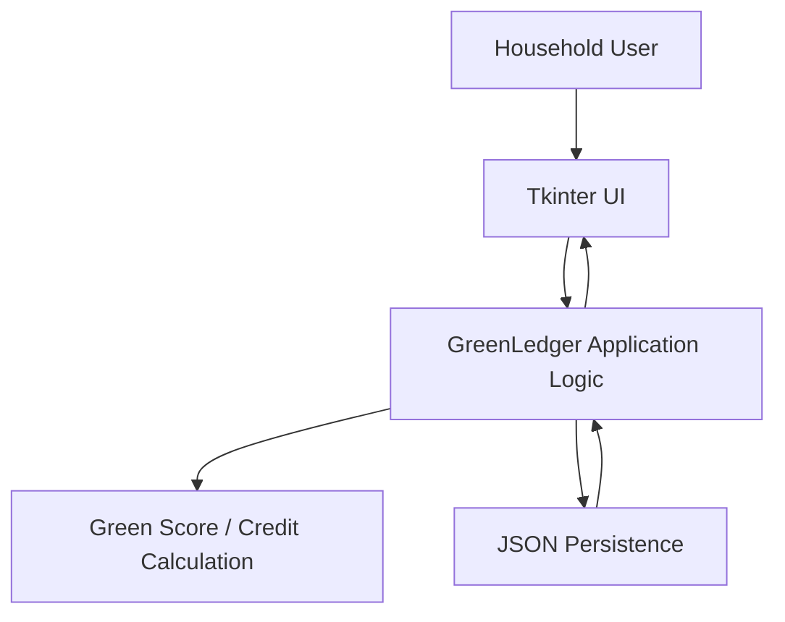

# 🌱 GreenLedger

**A digital incentive-based household waste segregation tracker for building better waste-management habits.**

GreenLedger is a Python/Tkinter working prototype that lets households record biodegradable and non-biodegradable waste, receive a Green Score, earn Green Credits, manage those credits in a digital wallet, and view community waste and Green Score rankings.

> **Hackathon prototype:** GreenLedger is a local desktop proof-of-concept. It uses JSON persistence and prototype authentication; it is not a production cloud service.

## Problem Statement

Households struggle to consistently segregate biodegradable and non-biodegradable waste at the source, resulting in poor waste-management practices, low accountability for individual waste-segregation behaviour, and unreliable household-level waste data for effective community and municipal waste management.

## Proposed Solution

GreenLedger turns household waste logging into a measurable incentive loop. A household records its biodegradable and non-biodegradable waste, the prototype calculates a Green Score, converts that score into Green Credits, stores credits in a Digital Green Wallet, and provides community-level waste visibility and a Green Score leaderboard.

## Social Impact

The prototype is designed to support:

- better household waste segregation
- accountability for waste-segregation behavior
- awareness of biodegradable vs. non-biodegradable waste
- incentive-based participation
- household-level waste tracking
- community visibility without publishing household points on the public waste board

No unverified real-world impact statistics are claimed by this repository.

## Key Features

- Household login and registration
- Dashboard with waste, score, credits, reward status, and recent activity
- Biodegradable/non-biodegradable waste logging
- Green Score calculation
- Green Credits calculation
- Digital Green Wallet
- Credit redemption and discount tiers
- Waste History
- Community Waste Board
- Green Score Leaderboard
- Built-in demo neighborhood data

## How Green Score Works

For a waste entry with biodegradable waste `bio_kg` and non-biodegradable waste `non_bio_kg`:

```text
Total waste = bio_kg + non_bio_kg
Segregation ratio = bio_kg / Total waste
Base score = Segregation ratio × 60
Efficiency = (1 − non_bio_kg / Total waste) × 20
Reduction bonus = e^(−Total waste / 5) × 20
Raw score = Base score + Efficiency + Reduction bonus
Green Score = min(100, round(Raw score, 2))
Green Credits = floor(Green Score / 5)
```

The implemented function is `calculate_green_score()` in `greenledger_app.py`. A zero-total entry returns `0.0` score and `0` credits; the UI prevents submitting an all-zero waste entry.

## Technology Stack

- **Python**
- **Tkinter / ttk** for the desktop UI
- **JSON** for prototype persistence
- **unittest** for automated business-logic tests

No third-party Python packages are required by the current application.

## Architecture



See [Architecture](docs/architecture.md) and the [Technical Design Document](docs/technical_design.md) for the detailed design.

## Project Structure

```text
GreenLedger/
├── README.md
├── LICENSE
├── .gitignore
├── requirements.txt
├── run.py
├── greenledger_app.py
├── data/
│   ├── greenledger_data.json
│   ├── sample_data.json
│   └── README.md
├── docs/
│   ├── architecture.md
│   ├── technical_design.md
│   ├── workflow.md
│   ├── features.md
│   ├── data_model.md
│   ├── testing.md
│   └── future_scope.md
├── tests/
│   ├── __init__.py
│   ├── test_green_score.py
│   ├── test_data_store.py
│   └── test_input_rules.py
└── screenshots/
    ├── README.md
    └── *.png
```

## Installation

### 1. Clone the repository

```bash
git clone <YOUR-GITHUB-REPOSITORY-URL>
cd GreenLedger
```

### 2. Create a virtual environment (recommended)

**Windows PowerShell:**

```powershell
python -m venv .venv
.\.venv\Scripts\Activate.ps1
```

**Windows Command Prompt:**

```bat
python -m venv .venv
.venv\Scripts\activate
```

**Linux/macOS:**

```bash
python3 -m venv .venv
source .venv/bin/activate
```

### 3. Install dependencies

The application uses Python's standard library, so there are no pip dependencies to install. On some Linux distributions, Tkinter may need to be installed separately, for example through the distribution's `python3-tk` package.

## Environment Variables

GreenLedger does **not** require environment variables, API keys, tokens, or external service credentials for the current prototype. All demo persistence is local JSON data.

## Run the Application

From the repository root:

```bash
python run.py
```

The application opens as a desktop Tkinter window.

## Demo Accounts

The prototype seeds demo households on startup. Each seeded demo household uses the password:

```text
demo
```

Example household IDs include:

- `House-01`
- `House-02`
- `House-03`
- `House-04`
- `House-05`

These are fictional demonstration records.

## Testing

Run all automated tests:

```bash
python -m unittest discover -s tests -v
```

See [Testing](docs/testing.md) for the test scope.

## Sample Data

The runtime data file is `data/greenledger_data.json`. A safe example is also provided as `data/sample_data.json`.

The application automatically creates/updates the local data file as users register, log waste, and redeem credits.

## Screenshots

The following screenshots were captured from the actual GreenLedger Tkinter prototype.

### Login / Registration


### Dashboard


### Log Waste + Green Score Result


### Waste History


### Green Wallet


### Community Waste Board


### Green Leaderboard


See the [screenshots directory](screenshots/README.md) for the full set.

## Documentation

- [Architecture](docs/architecture.md)
- [Technical Design Document](docs/technical_design.md)
- [Workflow](docs/workflow.md)
- [Features](docs/features.md)
- [Data Model](docs/data_model.md)
- [Testing](docs/testing.md)
- [Future Scope](docs/future_scope.md)

## Limitations

This is a working desktop prototype, not a production deployment. Current limitations include:

- local JSON persistence
- desktop Tkinter UI
- prototype authentication with locally stored passwords
- no cloud backend
- no real payment or reward-partner integration
- no verified municipal integration

## Security Note

Passwords are stored locally in the JSON data file in the current prototype. They are **not hashed**. Do not use this authentication design for a production deployment. A production version should use secure password hashing, authenticated APIs, access controls, and encrypted data transport/storage.

## Future Scope

Potential future improvements include a secure cloud backend, mobile clients, municipal integration, QR-based collection verification, real reward partners, analytics, notifications, and stronger privacy controls.

These are future possibilities and are not represented as implemented features.

## Contributing

1. Fork the repository.
2. Create a feature branch.
3. Make and test your changes.
4. Update documentation when behavior changes.
5. Open a pull request describing the change.

## License

GreenLedger is released under the [MIT License](LICENSE).

## Disclaimer

GreenLedger is an educational/social-cause prototype demonstrating an incentive-based approach to household waste tracking. It should not be treated as a production waste-management, authentication, payment, or municipal system without further engineering and validation.
